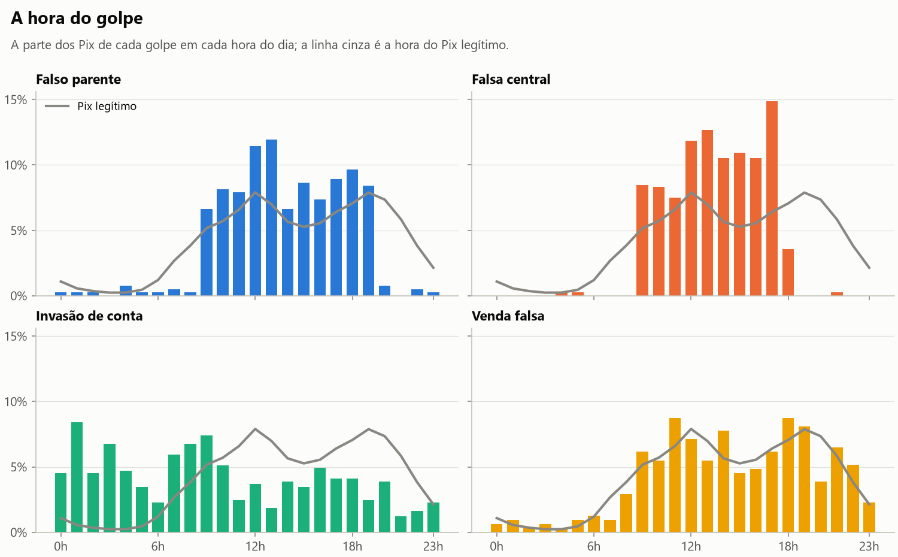
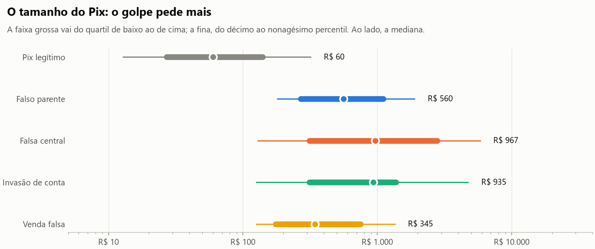
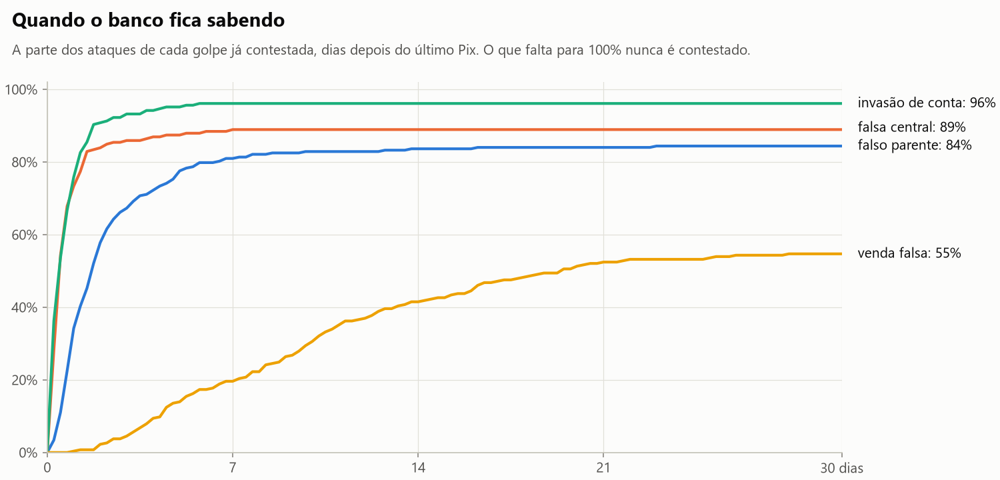
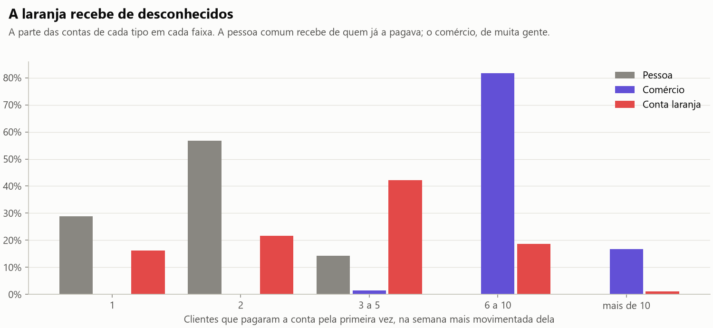
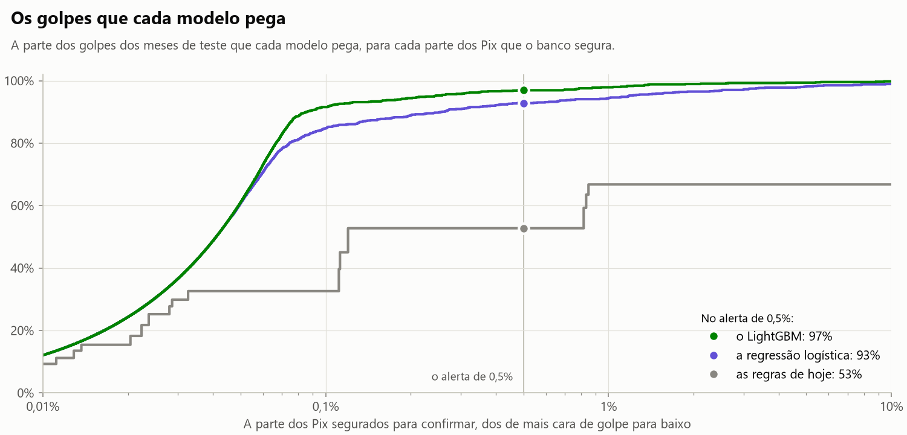
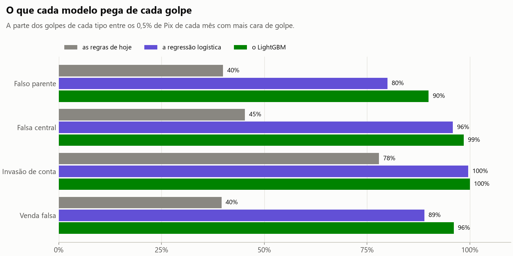
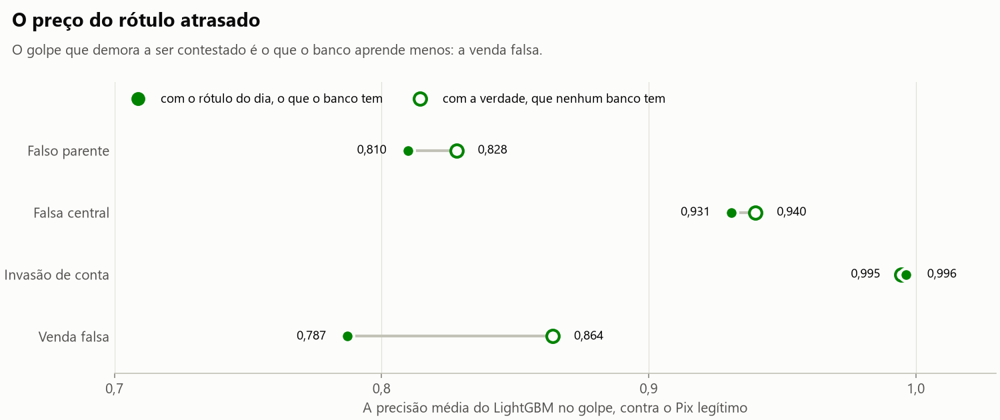
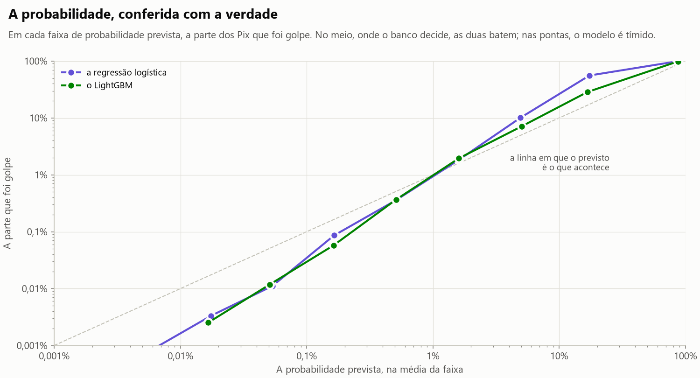
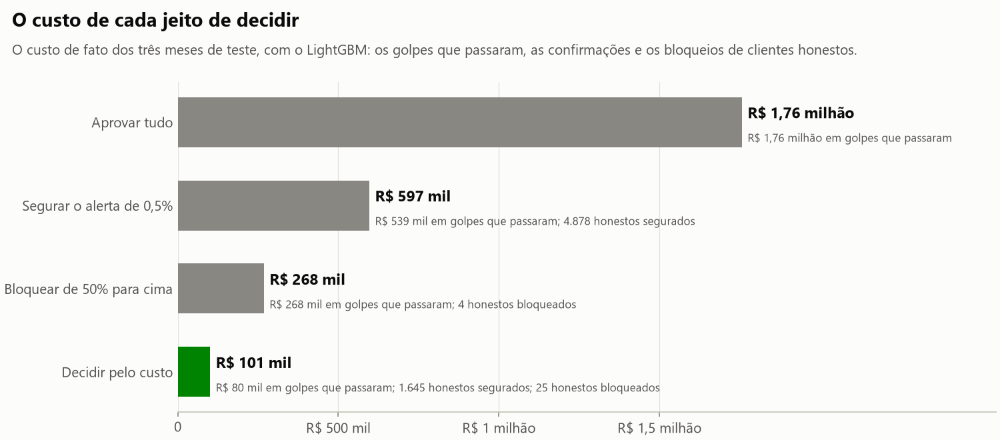
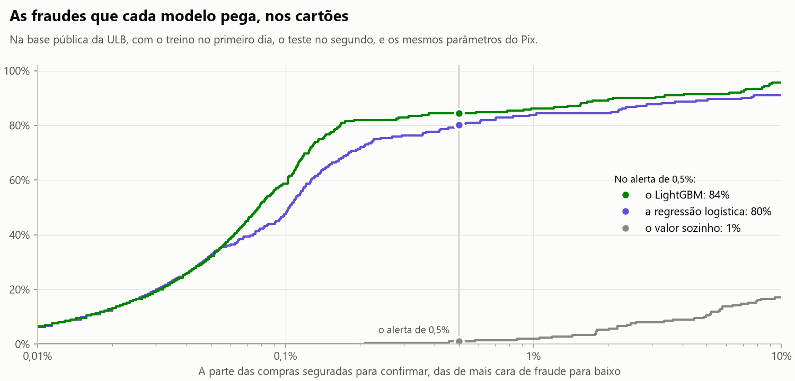

# Antifraude Pix

[](https://github.com/MarcusBomfim/antifraude-pix/actions/workflows/ci.yml)
[](LICENSE)

Detecção de fraude em Pix, do lado do banco de quem paga: o banco tem alguns milissegundos para decidir se cada Pix sai, segura para confirmar ou é bloqueado. O projeto começa por um simulador de transações com os golpes que acontecem no Brasil — o falso parente, a falsa central, a invasão de conta e a venda falsa — e com o rótulo que o banco tem de verdade: a contestação, que chega dias depois e nem sempre chega. Sobre esses dados vêm as variáveis calculadas sem olhar o futuro, os modelos validados no tempo com o rótulo que o banco tinha no dia, e a decisão de cada Pix pelo custo, explicada em português e medida para não errar mais com os mais velhos. Os experimentos ficam rastreados no MLflow, o modelo vai registrado com a sua ficha, e o mesmo processo roda numa base real, de cartões. Nas próximas partes, vêm o serviço que pontua em tempo real, o monitoramento e a entrega.

Python 3.13 · uv · NumPy · Polars · Parquet · scikit-learn · LightGBM · MLflow · matplotlib · pytest · hypothesis · ruff · mypy · GitHub Actions

> Projeto independente, de estudo e portfólio. Não tem ligação com nenhum banco nem com o Banco Central. Os dados são de um simulador: não há nenhum dado real de cliente, nem nenhuma transação de verdade.

## O problema

O Pix é instantâneo e irrevogável: depois que sai, o dinheiro só volta se o banco de quem recebeu ainda o encontrar na conta. A decisão de deixar sair é tomada antes, em milissegundos, e erra dos dois lados. Deixar passar o golpe custa o dinheiro da vítima. Segurar o Pix do cliente honesto custa a confiança dele, e o cliente vai para outro banco.

O golpe que mais cresce não é o de quem invade a conta, e sim o de quem convence a vítima a pagar. A vítima faz o Pix do celular dela, de dia, com a senha dela. Do lado do banco, parece um Pix como outro qualquer.

Por isso o problema é difícil, e é o que uma vaga de machine learning em banco cobra:

- **A fraude é rara**: perto de 0,1% dos Pix. Um modelo que nunca acusa nada acerta 99,9%, e não serve para nada.
- **O rótulo chega atrasado.** O banco só sabe que foi golpe quando a vítima reclama: horas depois, na invasão de conta; dias, na venda falsa. Treinar com o que ainda não foi contestado é treinar com golpe marcado como legítimo.
- **O rótulo é sujo.** Parte das vítimas nunca reclama, e há quem conteste um Pix legítimo.
- **O passado não pode ver o futuro.** Cada variável tem de ser calculada só com o que o banco sabia na hora do Pix.
- **O erro custa diferente** para cada lado, e o limiar sai do custo, e não do 0,5.
- **A decisão tem de ser explicada.** A LGPD (art. 20) dá direito à revisão da decisão automatizada.
- **O fraudador muda de tática**, e o modelo envelhece.

## Os dados

Não existe base pública de Pix, por causa do sigilo bancário. Os dados vêm de um simulador próprio, com as suposições escritas e testadas ([ADR-0002](docs/adr/0002-dados-sinteticos.md)).

- **O banco vê o que um banco vê**: o cadastro, os Pix, os aparelhos novos e, dias depois, as contestações. A verdade — qual Pix foi golpe, de que tipo, e qual conta é laranja — fica em outra pasta, para medir. O modelo nunca a lê ([ADR-0004](docs/adr/0004-o-rotulo-atrasado-e-o-contrato-dos-dados.md)).
- **Os golpes são do jeito que acontecem** ([ADR-0003](docs/adr/0003-os-golpes.md)):
  - o falso parente mira os mais velhos, com um a três Pix de valor redondo, de R$ 150 a R$ 3.000, do aparelho da própria vítima;
  - a falsa central liga em horário comercial e esvazia a conta em minutos;
  - a invasão vem de poucos aparelhos da quadrilha, muitas vezes de madrugada, dentro do limite noturno;
  - a venda falsa cresce na Black Friday, com o preço terminado em 90 centavos.
- **A conta laranja** recebe de várias vítimas por alguns dias e some. Quase sempre é uma pessoa; uma em cada cinco é uma empresa de fachada.
- **O legítimo também parece golpe**: troca de celular, paga o autônomo que nunca pagou em valor redondo, ajuda a família, faz Pix de madrugada e, de vez em quando, um Pix grande. Sem isso, o modelo bloquearia todo recebedor novo.
- **A mesma semente dá os mesmos dados, byte a byte.**

A simulação padrão, com a semente 2026:

| | |
|---|---|
| Clientes | 20.000, de julho a dezembro de 2025 |
| Pix | 2.393.510 |
| Pix de golpe | 1.922 (0,08%), em 1.145 ataques |
| Ataques | 358 de venda falsa, 314 de falso parente, 247 de invasão de conta, 226 de falsa central |
| Contas laranja | 204, das quais 41 empresas de fachada |
| Contestados | 1.645 dos Pix de golpe (86%); 277 nunca foram contestados |
| Pix legítimos contestados | 159 |
| Aparelhos novos | 2.656, dos quais 2.409 de clientes que trocaram de celular |

### O retrato

As figuras saem dos dados com `uv run python -m antifraude_pix.analise`.



A falsa central liga em horário comercial; a invasão de conta acontece a qualquer hora, inclusive de madrugada, quando a vítima dorme. A venda falsa tem a hora do Pix comum: a hora sozinha não a denuncia.



O golpe pede mais: de seis a dezesseis vezes a mediana do Pix comum. De madrugada, o golpista da invasão leva o limite noturno inteiro, R$ 1.000, muitas vezes num Pix só.



A invasão de conta é contestada em horas, e a venda falsa, em semanas — quando é. Um modelo treinado com os dados de ontem ainda não sabe da maior parte da venda falsa da última semana.



A conta laranja recebe de muita gente que nunca a pagou, em poucos dias. A pessoa comum recebe de quem já a pagava. O comércio também recebe de muita gente nova, e é ele que confunde: o rastro do recebedor ajuda, mas não basta.

## As variáveis

Cada Pix ganha 33 variáveis, calculadas só com o que o banco sabia antes dele ([ADR-0005](docs/adr/0005-a-visao-do-banco-e-o-corte-no-tempo.md), [ADR-0006](docs/adr/0006-as-variaveis-no-ponto-do-tempo.md)). Elas vêm em seis grupos:
- **o Pix**: o valor, a hora, a chave, o valor redondo, a parte do saldo;
- **o cliente**: a idade, a renda, o valor sobre a renda;
- **o hábito do cliente**: os Pix da última hora, o valor típico de 90 dias, quantas vezes o Pix é ele;
- **o cliente e o recebedor**: quantas vezes já pagou, há quanto tempo;
- **o recebedor**, entre todos os clientes do banco: os pagadores novos, as contestações que já tinham chegado;
- **o aparelho**: há quantos minutos entrou, e em quantas contas de outros clientes já tinha entrado.

A figura mede o quanto cada uma, sozinha, separa cada golpe do Pix legítimo. A medida usa a verdade do simulador, de propósito: é uma análise, e o modelo não a lê.


Cada golpe deixa um rastro diferente:
- **a invasão de conta**: o aparelho que acabou de entrar, e que já esteve em contas de outros clientes. Ele só aparece nela;
- **a venda falsa**: o preço de anúncio;
- **a falsa central**: a pressa, com o Pix da última hora e os poucos minutos desde o anterior;
- **o falso parente**: nenhum rastro próprio. Sobra o valor fora do hábito, e o autônomo também cobra em valor redondo, de alguém que o cliente nunca pagou.

Nenhuma variável basta sozinha, porque o golpe é raro. Para pegar 80% dos golpes só pelo valor, o banco seguraria um Pix legítimo em cada seis: 244 Pix de clientes honestos para cada golpe pego. Juntar as variáveis num modelo e decidir pelo custo são as Partes 3 e 4.

## Os modelos

Três modelos aprendem, mês a mês, com o que o banco sabia na véspera ([ADR-0007](docs/adr/0007-a-validacao-no-tempo-e-o-rotulo-do-dia.md), [ADR-0008](docs/adr/0008-os-modelos-e-a-calibracao.md)):
- **as regras de hoje**: seis regras escritas à mão, cada uma com os seus pontos. Entre elas, o aparelho novo, o recebedor já contestado e o Pix fora do hábito para quem o cliente nunca pagou;
- **a regressão logística**, com os números em logaritmo e o vazio indicado;
- **o LightGBM**, com árvores rasas e muitas.

Nenhum dos três recebe a idade do cliente: ela saiu do modelo na Parte 4 ([ADR-0011](docs/adr/0011-a-idade-fora-do-modelo.md)). O treino de cada mês usa o rótulo do dia: o Pix é golpe se foi contestado até ali, e mais nada. A probabilidade é calibrada em Pix antigos, que o modelo não viu. A medida é contra a verdade do simulador, nos três meses de teste, de outubro a dezembro, com 1,16 milhão de Pix e 948 golpes ([ADR-0009](docs/adr/0009-as-metricas-para-classe-rara.md)):

| | Precisão média | Golpes pegos | Dinheiro salvo | Honestos por golpe | Golpes previstos |
|---|--:|--:|--:|--:|--:|
| as regras de hoje | 0,42 | 53% | 76% | 1,7 | 1.361 |
| a regressão logística | 0,87 | 93% | 97% | 5,6 | 860 |
| o LightGBM | 0,93 | 97% | 99% | 5,3 | 929 |

Os golpes pegos, o dinheiro salvo e os honestos são do alerta: os 0,5% de Pix de cada mês com mais cara de golpe, que o banco segura para confirmar com o cliente.



O LightGBM pega 97% dos golpes segurando 0,5% dos Pix. As regras pegam pouco mais da metade, e segurar mais não as ajuda muito: com 10% dos Pix segurados, ainda deixam passar um terço dos golpes. Elas também seguram menos que os 0,5%, porque os Pix empatados nos mesmos pontos não cabem todos no alerta; por isso os honestos por golpe delas parecem melhores.



O falso parente é o golpe mais difícil, porque sai do aparelho da vítima, de dia, para uma pessoa, num valor que o autônomo também cobra. A invasão de conta é a mais fácil: o aparelho da quadrilha a denuncia.



No total, o rótulo atrasado custa pouco: 0,932 de precisão média com o rótulo do dia, contra 0,948 com a verdade, que nenhum banco tem. Quase todo o custo está na venda falsa, que é contestada em semanas, quando é. Esperar o rótulo amadurecer não ajuda: esperando 28 dias, o LightGBM cai para 0,928, porque perde os golpes mais recentes.



A probabilidade fecha a conta: o LightGBM previu 929 golpes, e houve 948. No meio, onde a decisão acontece, a probabilidade prevista bate com o que acontece; nas pontas, o modelo é tímido.

Os números são de um simulador, e um banco de verdade fica abaixo deles. O que vale levar daqui é a comparação entre os modelos, a diferença entre os golpes e o método de medir.

## A decisão e o porquê

A probabilidade vira decisão pelo custo de cada lado ([ADR-0010](docs/adr/0010-a-decisao-pelo-custo.md)). O banco tem três saídas para cada Pix: aprovar, segurar alguns minutos para confirmar com o cliente, ou bloquear. Cada erro tem um preço, e os preços são suposições escritas, de ordem de grandeza:
- o golpe que passa custa o valor dele;
- segurar um Pix para confirmar custa R$ 10;
- bloquear o Pix de um cliente honesto custa R$ 150;
- a confirmação para 70% dos golpes, porque a vítima convencida confirma.

Cada Pix vai para a saída de menor custo esperado. Por isso o limiar depende do valor: o Pix de R$ 50 só é segurado com 29% de chance de golpe, e o de R$ 3.000, com 0,5%.


Nos três meses de teste, com o LightGBM:

| | Custo | Perdido em golpes | Golpes parados | Honestos segurados | Honestos bloqueados |
|---|--:|--:|--:|--:|--:|
| aprovar tudo | R$ 1.757 mil | R$ 1.757 mil | 0 | 0 | 0 |
| segurar o alerta de 0,5% | R$ 597 mil | R$ 539 mil | 643 | 4.878 | 0 |
| bloquear de 50% para cima | R$ 268 mil | R$ 268 mil | 766 | 0 | 4 |
| **decidir pelo custo** | **R$ 101 mil** | **R$ 80 mil** | **842** | **1.645** | **25** |



Decidir pelo custo custa um décimo do que custa o banco sem defesa, e mexe em pouco: segura 0,15% dos Pix e bloqueia 0,07%. Segurar não basta, porque a confirmação deixa passar 30% de cada golpe segurado: o golpe com muita cara de golpe tem de ser bloqueado. Os preços mudam o custo, e não a escolha: em 27 combinações de preços, decidir pelo custo foi sempre o mais barato.

Cada Pix segurado ou bloqueado sai com as suas razões, em português ([ADR-0012](docs/adr/0012-a-explicacao-em-portugues.md)). A LGPD (art. 20) dá ao cliente o direito de pedir a revisão de uma decisão automatizada, e quem revisa precisa saber o que pesou. As razões saem dos valores de Shapley das árvores: o quanto cada variável empurrou a pontuação, numa conta em que a base mais as contribuições dá a própria pontuação. As três que mais empurraram para o golpe viram frases, com o valor de cada uma. Por exemplo:

> Bloqueado, com 80% de chance de golpe: 2 Pix para este recebedor já tinham sido contestados como golpe; o recebedor não recebeu nenhum Pix de clientes do banco nas 24 horas anteriores; e é o primeiro Pix do cliente para este recebedor.

> Segurado para confirmar com o cliente, com 0,8% de chance de golpe: o Pix é 89% da renda mensal do cliente; é o primeiro Pix do cliente para este recebedor; e o Pix é de R$ 7.100,00.

O segundo era de um cliente honesto: um Pix grande, para alguém novo. É o erro que a confirmação existe para resolver.

O golpe mira os mais velhos, e o modelo da Parte 3, que recebia a idade, aprendeu a desconfiar deles ([ADR-0011](docs/adr/0011-a-idade-fora-do-modelo.md)). Medindo os erros por faixa de idade, ele bloqueava o Pix honesto de quem tem 65 anos ou mais 19 vezes mais que o de quem tem de 18 a 34. A idade saiu do modelo:


Sem a idade, o modelo pega os mesmos golpes contra os mais velhos (93%), e bloqueia o Pix honesto deles como o de qualquer idade. O custo subiu 0,9%. O honesto de 65 anos ou mais ainda é segurado quase três vezes mais, porque o golpe contra eles é quatro vezes mais comum, e o hábito deles se parece com o das vítimas. Cada Pix segurado de um idoso, por outro lado, é golpe mais vezes que o de um jovem.

## Os experimentos, o modelo registrado e a base real

Cada medida que decidiu o desenho dos modelos vira uma corrida no MLflow ([ADR-0013](docs/adr/0013-os-experimentos-rastreados-no-mlflow.md)): o padrão, o rótulo da verdade, a espera pelo rótulo e a idade no modelo. Cada corrida guarda:
- **os dados**: a configuração da simulação, que dá os mesmos dados byte a byte;
- **os parâmetros**: os do modelo, os do treino e os da decisão;
- **as métricas**: as da fila, as de cada golpe, as da decisão e as de cada faixa de idade, e a precisão média mês a mês;
- **o código**: o commit.

| Variante | O LightGBM, de outubro a dezembro |
|---|--:|
| o padrão | 0,932 |
| aprendendo com a verdade, que nenhum banco tem | 0,948 |
| esperando 14 dias o rótulo amadurecer | 0,928 |
| esperando 28 dias | 0,928 |
| recebendo a idade, como na Parte 3 | 0,934 |

O modelo que vai para o banco fica registrado no MLflow como `antifraude-pix`, com o apelido `campeao` ([ADR-0014](docs/adr/0014-o-modelo-registrado-com-a-ficha.md)). Ele é o LightGBM treinado com tudo o que o banco sabia no fim de 2025, num pacote só: entram as 32 variáveis de um Pix, e saem a probabilidade, a decisão e a explicação. O que ele aprendeu vai em formatos que se leem sem executar nada, e não em pickle:
- as árvores, no texto do próprio LightGBM;
- a calibração e os custos, em JSON.

A [ficha do modelo](docs/ficha-do-modelo.md) diz o que ele faz e para que não serve, com que dados aprendeu, como foi medido e onde erra. Ela sai das próprias medidas, e vai junto com ele no registro.

```python
import mlflow

modelo = mlflow.pyfunc.load_model("models:/antifraude-pix@campeao")
decisoes = modelo.predict(variaveis)  # pontuacao, probabilidade, acao e explicacao
```

Não existe base pública de Pix. Por isso o mesmo processo roda na base pública de fraude mais usada, a de cartões da ULB ([ADR-0015](docs/adr/0015-a-base-publica-de-cartoes.md)):
- são 284.807 compras de clientes europeus em dois dias de 2013, com 492 fraudes;
- as variáveis são componentes principais, sem nome.

O treino é o primeiro dia, e o teste, o segundo. Os modelos usam os parâmetros do Pix, sem ajuste nenhum, e a medida usa as mesmas funções.



| | Precisão média | Fraudes pegas no alerta | Fraudes previstas | Custo pelo custo |
|---|--:|--:|--:|--:|
| o valor sozinho | 0,002 | 1% | 236 de 211 | € 27.069 |
| a regressão logística | 0,66 | 80% | 241 de 211 | € 16.006 |
| o LightGBM | 0,79 | 84% | 252 de 211 | € 11.613 |

O processo se sustenta fora do simulador, e a ordem dos modelos é a mesma. A base real é mais difícil, e mostra o que o simulador não mostrava:
- **o valor aponta para o lado errado**: a fraude com cartão é pequena, com mediana de € 9,21, contra € 20,33 da compra honesta;
- **a taxa de fraude muda de um dia para o outro**, de 0,19% para 0,15%. A probabilidade calibrada no primeiro dia prevê fraude demais no segundo, e é a mudança que a Parte 7 vai vigiar;
- **decidir pelo custo corta 57% do custo de aprovar tudo** (€ 26.889), e não 94%, como no Pix. Para a fraude de poucos euros, confirmar custaria mais que a fraude.

## Roteiro

O projeto é construído em partes, cada uma entregue funcionando, testada e documentada.

| Parte | Conteúdo | |
|--:|---|---|
| 1 | O simulador do Pix: a população, a rotina de cada cliente, os quatro golpes, a contestação atrasada, o contrato dos dados e o retrato | ✅ |
| 2 | As variáveis sem olhar o futuro: o valor fora do hábito, a pressa, o recebedor novo, a conta que recebe de muitos desconhecidos, o aparelho novo — com testes que provam que não há vazamento | ✅ |
| 3 | Os modelos: as regras de hoje como ponto de partida, a regressão logística e o LightGBM; a validação no tempo, com o rótulo que o banco tinha no dia; as métricas para classe rara; a probabilidade calibrada | ✅ |
| 4 | A decisão e o porquê: aprovar, segurar para confirmar ou bloquear, pelo custo; a explicação em português de cada decisão; o modelo que não erra mais com os mais velhos | ✅ |
| 5 | Os experimentos rastreados no MLflow, o modelo registrado com a sua ficha, e o mesmo processo numa base pública real, de cartões | ✅ |
| 6 | A pontuação em tempo real: a API em FastAPI, a latência medida, e o teste de que a API e o treino calculam as mesmas variáveis | |
| 7 | O monitoramento: os dados que mudam, o rótulo que chega depois, o golpe novo, e o retreino comparando o modelo atual com o candidato | |
| 8 | Docker, entrega contínua, OpenTelemetry e o painel | |

## O que já está pronto

**Parte 1 — o simulador do Pix**

- **A população**: os clientes do banco, com idade, estado, renda, conta, limite noturno e o círculo de cada um — os contatos, os comércios preferidos, o aluguel. Do outro lado, as contas que recebem: pessoas, comércios (poucos muito populares, muitos pouco) e as laranjas, ativas de dois a vinte dias, três vezes mais nos bancos digitais.
- **O calendário bancário**: os feriados nacionais, os móveis calculados a partir da Páscoa, os dias úteis e o salário até o quinto dia útil.
- **A rotina de cada cliente**, executada como o banco executa: o salário entra, o aluguel sai, o comércio no almoço e no fim do dia, o Pix sem saldo não sai, e o noturno não passa do limite.
- **Os quatro golpes**, cada um com a sua vítima, a sua hora e a sua mecânica, e a quadrilha da invasão usando os mesmos aparelhos em contas diferentes.
- **A contestação**, com a chance e a demora de cada golpe, dentro do prazo do MED, e os Pix legítimos contestados mesmo assim.
- **O contrato dos dados**: colunas e tipos fixos, categorias fechadas, dinheiro em centavos, instante com o fuso de Brasília; e a validação de fora, que diz todos os problemas de uma vez, em frases.
- **Os dados em Parquet**, o banco numa pasta e a verdade em outra, com o manifesto que guarda a configuração e o SHA-256 de cada arquivo.

**Parte 2 — as variáveis sem olhar o futuro**

- **O simulador mais difícil.** Medir as variáveis mostrou que a primeira versão separava o falso parente só pelo valor. Entraram o autônomo, a ajuda da família, a laranja de fachada e o falso parente que pede pouco (a revisão da [ADR-0003](docs/adr/0003-os-golpes.md)).
- **A visão do banco**, um tipo sem nenhum campo para a verdade:
  - ela tem o cadastro, os Pix, os aparelhos novos e as contestações;
  - a leitura do disco abre só a pasta do banco, e confere o SHA-256 dela;
  - o corte num instante devolve o banco daquele momento, com as contestações que já tinham chegado.
- **Trinta e três variáveis, em seis grupos**, num catálogo com o nome, o tipo e uma frase em português para cada uma.
- **Toda janela no tempo é fechada à esquerda**: o Pix não entra nas contas dele mesmo, nem nas de outro Pix do mesmo segundo.
- **O cálculo em lote**, com o Polars: as variáveis dos 2,4 milhões de Pix da simulação padrão em cerca de seis segundos.
- **A força de cada variável**, sozinha, contra cada golpe: a área sob a curva ROC, com o vazio contado como o menor valor.

**Parte 3 — os modelos**

- **A validação no tempo**, uma dobra por mês: o treino com tudo o que veio antes do corte, e o teste no mês do corte. Setembro ficou para escolher os parâmetros, e o teste vai de outubro a dezembro.
- **O rótulo do dia**: o Pix é golpe se foi contestado antes do corte. O treino não espera o rótulo amadurecer, porque esperar custa mais que o rótulo atrasado.
- **Três modelos**:
  - as regras de hoje, com os seus pontos;
  - a regressão logística, com o preparo ajustado só no treino;
  - o LightGBM, com todos os golpes e um legítimo em cada dez, com peso dez.
- **A probabilidade calibrada** pelo método de Platt, em Pix maduros que o modelo não viu.
- **As métricas para classe rara**:
  - a precisão média;
  - no alerta de 0,5% dos Pix de cada mês, os golpes pegos, o dinheiro salvo e os honestos segurados por golpe;
  - cada golpe separado;
  - a calibração contra a verdade.

**Parte 4 — a decisão e o porquê**

- **A decisão pelo custo**: aprovar, segurar para confirmar ou bloquear, a saída de menor custo esperado para a probabilidade e o valor de cada Pix. Os preços de cada erro são suposições escritas, num lugar só.
- **O custo de fato, contra a verdade**: o custo de aprovar tudo, de segurar o alerta de 0,5%, de bloquear de 50% para cima e de decidir pelo custo, com os golpes parados e os honestos segurados e bloqueados.
- **A idade fora do modelo.** Ela continua no cadastro, para medir, e os modelos recebem as outras 32 variáveis.
- **Os erros por idade**: os golpes pegos e os honestos segurados e bloqueados em cada faixa, de 18 a 34 anos até 65 ou mais.
- **A explicação em português** de cada Pix segurado ou bloqueado:
  - as três variáveis que mais empurraram a pontuação para o golpe, cada uma numa frase com o valor dela;
  - pelos valores de Shapley no LightGBM, pelos pesos na regressão logística e pelos pontos nas regras;
  - a idade, que não entra no modelo, não tem frase.

**Parte 5 — os experimentos, o modelo registrado e a base real**

- **O rastreio no MLflow**, num banco SQLite ao lado dos dados: uma corrida por modelo de cada variante, com os dados, os parâmetros, as métricas e o commit.
- **O modelo registrado**, com nome, versão e o apelido de campeão:
  - a probabilidade, a decisão e a explicação num pacote só;
  - as árvores em texto e os ajustes em JSON, sem pickle;
  - a assinatura das 32 variáveis, com as que podem vir vazias;
  - o código e as versões das bibliotecas.
- **A ficha do modelo**, gerada das medidas.
- **A base de cartões da ULB**, baixada do OpenML e conferida pelo MD5, com o mesmo processo do Pix e as mesmas métricas.

## Decisões

As decisões que mudam o desenho do projeto estão registradas em [`docs/adr`](docs/adr):

- [ADR-0001](docs/adr/0001-python-e-as-ferramentas.md) — Python, e as ferramentas que tratam o código de dados como código.
- [ADR-0002](docs/adr/0002-dados-sinteticos.md) — os dados são de um simulador, do lado de quem paga, com a verdade guardada à parte.
- [ADR-0003](docs/adr/0003-os-golpes.md) — os golpes: quatro, do jeito que acontecem, e o legítimo que parece golpe.
- [ADR-0004](docs/adr/0004-o-rotulo-atrasado-e-o-contrato-dos-dados.md) — o rótulo atrasado e sujo, o contrato dos dados, e a verdade em outra pasta.
- [ADR-0005](docs/adr/0005-a-visao-do-banco-e-o-corte-no-tempo.md) — a visão do banco, e o corte no tempo: o que o banco sabia em cada instante.
- [ADR-0006](docs/adr/0006-as-variaveis-no-ponto-do-tempo.md) — as variáveis no ponto do tempo: cada uma com o que o banco sabia antes do Pix.
- [ADR-0007](docs/adr/0007-a-validacao-no-tempo-e-o-rotulo-do-dia.md) — a validação no tempo, e o rótulo do dia: o modelo aprende com o que o banco sabia.
- [ADR-0008](docs/adr/0008-os-modelos-e-a-calibracao.md) — os modelos: as regras de hoje, a regressão logística e o LightGBM, com a probabilidade calibrada.
- [ADR-0009](docs/adr/0009-as-metricas-para-classe-rara.md) — as métricas para classe rara: o topo da fila, o alerta do mês, cada golpe e a calibração.
- [ADR-0010](docs/adr/0010-a-decisao-pelo-custo.md) — a decisão pelo custo: aprovar, segurar para confirmar ou bloquear.
- [ADR-0011](docs/adr/0011-a-idade-fora-do-modelo.md) — a idade fora do modelo, e os erros por idade.
- [ADR-0012](docs/adr/0012-a-explicacao-em-portugues.md) — a explicação em português de cada decisão.
- [ADR-0013](docs/adr/0013-os-experimentos-rastreados-no-mlflow.md) — os experimentos rastreados no MLflow.
- [ADR-0014](docs/adr/0014-o-modelo-registrado-com-a-ficha.md) — o modelo registrado, com a sua ficha.
- [ADR-0015](docs/adr/0015-a-base-publica-de-cartoes.md) — o mesmo processo numa base real: a de cartões da ULB.

## Testes

- **O calendário conferido com datas conhecidas e com propriedades sorteadas.** A Páscoa de 2008, 2025 e 2285. A Páscoa sempre num domingo entre 22 de março e 25 de abril, em qualquer ano. O quinto dia útil sempre útil, e com quatro dias úteis antes, em qualquer mês.
- **A população no que ela promete**:
  - os adultos, a renda acima do mínimo, a conta antiga;
  - os contatos e os comércios que existem, sem repetir;
  - o aluguel que cabe na renda;
  - a chave certa para cada tipo de conta;
  - as laranjas mais nos bancos digitais;
  - as idades e os estados nas proporções da população.
- **Os golpes, cada um no seu jeito**:
  - o falso parente e a falsa central mirando os mais velhos;
  - o falso parente pedindo de R$ 150 a R$ 3.000, e o pedido pequeno comum;
  - a falsa central em dia de semana;
  - a venda falsa crescendo na Black Friday;
  - a invasão vindo de poucos aparelhos;
  - o valor redondo, a parte do saldo e o preço de anúncio.
- **A rotina**: a de um cliente sai igual simulada sozinha. O legítimo também troca de celular, paga desconhecidos, faz Pix de madrugada e Pix grande, paga o autônomo como se fosse o falso parente e ajuda a família em valor alto e redondo.
- **A contestação**: o ataque contestado inteiro e de uma vez, cada golpe na proporção dele, a invasão contestada logo e a venda falsa depois de dias.
- **Os dados adulterados**, um para cada regra do contrato — dezenove, do Pix fora do período à contestação depois do prazo do MED — recusados com a frase certa.
- **Qualquer simulação pequena segue o contrato**: de 5 a 60 clientes, de 1 a 40 dias, com qualquer semente, taxa de golpes e data de início, sorteados pelo hypothesis.
- **A gravação**: o que se grava é o que se lê, os mesmos dados dão os mesmos arquivos, e o arquivo mexido depois de gravado é recusado.
- **A visão do banco**:
  - não tem campo para a verdade;
  - o corte guarda só o que veio antes, e deixa de fora a contestação de um Pix antigo feita depois;
  - o instante com fuso é recusado;
  - a leitura funciona com a pasta da verdade apagada;
  - o arquivo do banco mexido é recusado.
- **O vazamento, provado de três jeitos**:
  - **o corte**: as variáveis calculadas com o banco cortado são idênticas às do banco inteiro, Pix por Pix. Vale em qualquer instante, inclusive o exato de um Pix, o de logo depois de uma contestação e o de um aparelho novo, e em minutos sorteados pelo hypothesis;
  - **os exemplos à mão**: dois clientes, seis Pix e uma quadrilha, com cada valor conferido. E as bordas de cada conta: dois Pix no mesmo segundo, a ponta de cada janela, a contestação e o aparelho que chegam no instante do Pix, a madrugada de domingo;
  - **o código**: o pacote das variáveis não importa o simulador nem a gravação, e não toca em nada chamado verdade.
- **Cada rastro, conferido com a verdade**:
  - o aparelho da invasão entrou minutos antes;
  - o aparelho de outras contas só aparece na invasão;
  - o primeiro Pix de cada ataque vai para um recebedor novo;
  - a venda falsa termina em 90 centavos.
- **A força**: a variável que separa tudo vale 1, nos dois sentidos; a que não separa nada, 0,5; o empate vale meio; o vazio é o menor valor.
- **O rótulo do dia e as dobras**:
  - uma dobra por mês, e a última até o fim dos dados;
  - o rótulo é o contestado antes do corte, e não sabe de todos os golpes;
  - a janela de treino é a mesma com o banco inteiro e com o banco do dia do corte.
- **O preparo**:
  - a logística é padronizada pelas contas do treino, e só dele;
  - o vazio vira zero com o indicador aceso;
  - a hora vai em casas;
  - as árvores recebem o vazio como vazio.
- **As regras**, cada uma com os seus pontos e a sua borda.
- **O treino**:
  - o mesmo treino com a mesma semente dá a mesma probabilidade;
  - a calibração é sorteada entre os Pix maduros que o treino não vê, e nela a soma das probabilidades é o número de golpes;
  - os modelos que aprendem ganham das regras.
- **A avaliação sem vazamento, de ponta a ponta**: cortar a simulação no meio do mês de teste não muda a pontuação de nenhum Pix anterior ao corte.
- **As métricas, conferidas em exemplos à mão**: o alerta de cada mês, o empate na fronteira, a precisão média, a área ROC, o dinheiro salvo, cada golpe, a calibração e a curva do alerta.
- **O código dos modelos**: o pacote não importa o simulador, a gravação, as análises nem a avaliação, e não toca na verdade.
- **A decisão pelo custo**:
  - cada Pix vai para a saída de menor custo esperado, conferida em exemplos à mão e em valores sorteados pelo hypothesis;
  - o limiar depende do valor, e o empate fica com a saída mais branda;
  - mais chance de golpe, ou mais dinheiro em jogo, nunca deixa a saída mais branda;
  - os preços sem sentido são recusados.
- **O custo de fato de cada jeito de decidir**, num mês feito à mão: o golpe e o honesto em cada saída, o alerta com o empate e o limiar na borda.
- **A idade fora do modelo**: mudar a idade de todos os clientes não muda a pontuação de nenhum Pix, em nenhum dos três modelos. Para medir, o modelo ainda pode recebê-la.
- **Os erros por idade**: as bordas de cada faixa, os dois erros e os golpes previstos, conferidos à mão.
- **A explicação**:
  - nos três modelos, a base mais as contribuições é a pontuação, até a nona casa;
  - as razões são as que mais empurraram para o golpe, sem repetir a frase;
  - na invasão de conta, o aparelho quase sempre está entre elas;
  - cada variável tem a sua frase para todo valor que aparece nos dados, e a idade não tem;
  - o pacote da decisão não importa o simulador nem a avaliação.
- **O rastreio**:
  - cada variante grava uma corrida por modelo, com as métricas iguais às da avaliação e com o que a variante muda;
  - a precisão média vai mês a mês, e as tabelas vão como artefatos;
  - o experimento é criado uma vez só, ao lado dos dados.
- **O modelo registrado**:
  - o campeão carregado do registro dá a mesma probabilidade que o modelo treinado, até a 12ª casa, e a mesma decisão;
  - os custos e os tipos gravados voltam iguais;
  - a assinatura tem as 32 variáveis, e as que podem vir vazias não são obrigatórias;
  - faltando variável, o modelo diz qual;
  - o lote em que todo Pix foi aprovado sai sem razões, e sem quebrar.
- **A base de cartões**, numa base pequena inventada no formato do OpenML:
  - a leitura, inclusive do número em notação científica;
  - o download que confere o MD5, joga fora o arquivo que não confere, e não baixa de novo;
  - o primeiro dia no treino e o segundo no teste;
  - a calibração fora do ajuste;
  - as métricas e a decisão do Pix medindo os cartões.
- **A linha de comando e as figuras**: o que sai, o que é recusado, e as figuras gravadas.

## Como rodar

Pré-requisito: o [uv](https://docs.astral.sh/uv/), que instala o Python certo e as dependências. No Windows:

```bash
winget install --id astral-sh.uv --exact
```

O ambiente, com as versões do `uv.lock`:

```bash
uv sync
```

A simulação padrão, em menos de dois minutos, gravada em `dados/`:

```bash
uv run antifraude-pix simular
```

Outra configuração, por exemplo menor e com outra semente:

```bash
uv run antifraude-pix simular --clientes 2000 --dias 60 --semente 7 --saida dados-pequenos
```

A conferência dos dados gravados:

```bash
uv run antifraude-pix validar
```

As variáveis de cada Pix, calculadas só com o que o banco sabia antes dele, gravadas em `dados/variaveis.parquet`:

```bash
uv run antifraude-pix variaveis
```

Os três modelos, treinados mês a mês com o rótulo do dia e medidos contra a verdade, em cerca de um minuto, com as pontuações gravadas em `dados/avaliacao.parquet`:

```bash
uv run antifraude-pix avaliar
```

A decisão de cada Pix de teste pelo custo, com o LightGBM de cada mês, a explicação de cada decisão e os erros por idade, em menos de um minuto, gravados em `dados/decisoes.parquet`:

```bash
uv run antifraude-pix decidir
```

As medidas que decidiram o desenho dos modelos, refeitas e gravadas no MLflow, em uns cinco minutos:

```bash
uv run antifraude-pix experimentos
```

O MLflow mostra as corridas no navegador, em http://127.0.0.1:5000:

```bash
uv run mlflow ui --backend-store-uri sqlite:///dados/mlflow/mlflow.db
```

O modelo final, treinado com tudo, registrado no MLflow como o campeão, com a ficha gravada em `dados/ficha-do-modelo.md`, em uns dois minutos:

```bash
uv run antifraude-pix registrar
```

O mesmo processo na base de cartões da ULB, que o comando baixa do OpenML na primeira vez (151 MB):

```bash
uv run antifraude-pix cartoes
```

As figuras deste README, em uns quatro minutos. A dos cartões só sai depois que a base foi baixada:

```bash
uv run python -m antifraude_pix.analise
```

Os testes, a formatação, o lint e os tipos, como o CI os roda:

```bash
uv run pytest
```

```bash
uv run ruff format --check .
```

```bash
uv run ruff check .
```

```bash
uv run mypy
```

## Estrutura

```text
src/antifraude_pix/
  simulacao/
    configuracao.py     os parâmetros da simulação inteira, cada um com o seu porquê
    calendario.py       os feriados, os dias úteis e o quinto dia útil
    sorteio.py          um fluxo de números para cada etapa e para cada cliente
    populacao.py        os clientes, as contas que recebem e as laranjas
    golpes.py           os quatro golpes: o plano dos ataques e os passos de cada um
    rotina.py           a rotina de cada cliente, executada como o banco executa
    contestacoes.py     o rótulo que chega atrasado
    pix.py              a iniciação e o relógio da simulação
    simulador.py        da semente às tabelas
  dados/
    esquema.py          o contrato: as colunas e os tipos de cada tabela
    validacao.py        o que tem de valer nos dados, conferido de fora
    gravacao.py         o banco numa pasta, a verdade em outra, e o manifesto
    banco.py            a visão do banco, sem a verdade, e o corte num instante
  variaveis/
    catalogo.py         as 33 variáveis: o nome, o grupo, o tipo e a frase de cada uma
    calculo.py          o cálculo em lote, cada variável só com o passado
  modelos/
    rotulo.py           o rótulo do dia, as janelas de treino e de teste, e as dobras no tempo
    preparo.py          as variáveis como matriz, do jeito de cada modelo, e sem a idade
    regras.py           as regras de hoje, com os seus pontos
    treino.py           os três modelos e a calibração de Platt
  avaliacao/
    no_tempo.py         o treino em cada corte e o teste no mês do corte, contra a verdade
    metricas.py         as métricas para classe rara
    decisoes.py         o custo de fato de cada jeito de decidir
    justica.py          os erros em cada faixa de idade
  rastreio/
    experimentos.py     as variantes, e cada corrida no MLflow
    registro.py         o modelo final, registrado com o apelido de campeão
    modelo_do_pix.py    o modelo registrado, como código: entram as variáveis, sai a decisão explicada
    ficha.py            a ficha do modelo, gerada das medidas
  cartoes/
    base.py             a base de cartões da ULB: o download conferido e a leitura
    processo.py         o mesmo processo do Pix, nos cartões
    rastreio.py         as corridas dos cartões no MLflow
  decisao/
    custo.py            aprovar, segurar ou bloquear: a saída de menor custo esperado
    explicacao.py       as razões de cada decisão, pela conta do próprio modelo
    frases.py           a frase de cada variável com o valor dela, em português
  analise/
    retrato.py          as contas do retrato de cada golpe
    separacao.py        a força de cada variável, sozinha, contra cada golpe
    figuras.py          as figuras do README
  cli.py                antifraude-pix simular, validar, variaveis, avaliar, decidir, experimentos, registrar e cartoes
tests/                  o simulador, os dados, as variáveis, os modelos, a avaliação, a decisão, o rastreio, os cartões e as análises
docs/adr/               decisões de arquitetura
docs/ficha-do-modelo.md a ficha do modelo registrado
docs/imagens/           as figuras do retrato, da força das variáveis, dos modelos, da decisão e dos cartões
```

## Licença

[MIT](LICENSE).
